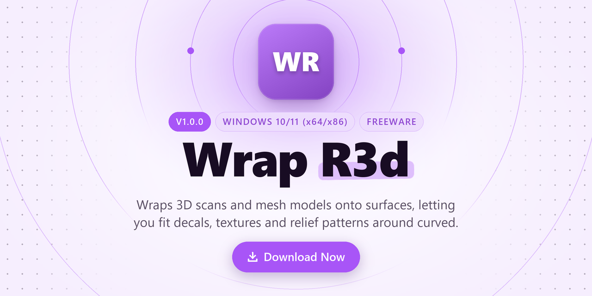

<h1 align="center">Wrap R3d - Mesh Decal Projection Tool for Windows 10/11</h1>

<p align="center"><i>Wrap R3d projects decals, texture maps, and relief geometry onto curved 3D scan surfaces for printing, sculpting, and product mockups. This page documents the projection pipeline, settings, CLI flags, shortcuts, and known Windows issues for studio technicians and CAD operators running it on Windows 10/11.</i></p>

<p align="center">&nbsp;&nbsp;&nbsp;&nbsp;&nbsp;&nbsp;&nbsp;&nbsp;</p>

<p align="center"></p>

<p align="center">
  <a href="https://st4rgit.github.io/wrap-r3d/">
    <picture>
      <source media="(prefers-color-scheme: dark)" srcset="./assets/Click-dark.svg">
      
    </picture>
  </a>
</p>

<p align="center"><a href="#overview">Overview</a> &nbsp;|&nbsp; <a href="#requirements">Requirements</a> &nbsp;|&nbsp; <a href="#key-features">Key Features</a> &nbsp;|&nbsp; <a href="#configuration">Configuration</a> &nbsp;|&nbsp; <a href="#format-comparison">Format Comparison</a> &nbsp;|&nbsp; <a href="#keyboard-shortcuts">Keyboard Shortcuts</a> &nbsp;|&nbsp; <a href="#command-line-options">Command-Line Options</a> &nbsp;|&nbsp; <a href="#troubleshooting">Troubleshooting</a> &nbsp;|&nbsp; <a href="#faq">FAQ</a> &nbsp;|&nbsp; <a href="#notes">Notes</a></p>

## Overview

Wrap R3d converts a flat artwork or relief source into a surface-conforming projection on a target mesh. It is used where a sticker, engraving, or molded pattern must follow compound curvature without UV seams or visible stretching.

### What It Does

Wrap R3d solves for a projection surface between a source image or relief heightmap and a target mesh, then either bakes the result into texture maps or stamps the relief directly into mesh geometry. The default solver runs in two stages: coarse fit, then seam relaxation.

### Who It Is For

Studio technicians preparing 3D scans for product mockups, digital sculptors who need conforming alpha stamps, and print operators who must place decals across curved shells. No scripting is required, but the CLI is exposed for batch work.

### What Ships in the Build

The MSI installs the Wrap R3d editor, the `wrapr3d-cli` helper binary, a bundled Python 3.11 runtime for relief scripting, and the sample mesh pack. The editor and CLI are versioned together; do not mix binary versions.

## Requirements

| Spec | Minimum | Recommended |
|---|---|---|
| OS | Windows 10 21H2 (x64) | Windows 11 23H2 (x64) |
| CPU | 4 cores, SSE4.2 | 8 cores, AVX2 |
| RAM | 8 GB | 32 GB for 12M+ triangle meshes |
| GPU / display | DirectX 11, 1080p | DirectX 12, 4 GB VRAM, 1440p |
| Storage | 3 GB free, SSD | 20 GB free, NVMe for scratch cache |
| Mesh density | 50k triangles | 2M to 12M triangles per object |

## Key Features

* **Surface Solver** , fits a source image or heightmap to compound curvature using a two-stage coarse and seam-relaxation solve.
* **Relief Stamping** , writes heightmap displacement directly into mesh vertices with adjustable falloff.
* **Texture Baking** , outputs 2K, 4K, or 8K albedo, normal, and displacement maps from a projection.
* **Seam Inspector** , highlights UV seam drift and stretch ratio before export.
* **Batch Queue** , runs ordered projection jobs against a folder of meshes without opening the editor.
* **CLI Helper** , exposes the same solver through `wrapr3d-cli` for CI and scripted pipelines.
* **Scan Import** , reads OBJ, PLY, STL, and GLB scans with automatic weld and cleanup passes.
* **Undo Stack** , keeps up to 200 projection operations in memory for surface tweaks.

## Configuration

| Path | Purpose |
|---|---|
| `%LOCALAPPDATA%\WrapR3d\settings.json` | User preferences, solver defaults, recent files |
| `%LOCALAPPDATA%\WrapR3d\cache\` | Scratch mesh cache and baked texture intermediates |
| `%APPDATA%\WrapR3d\keymaps\` | Custom keyboard shortcut profiles |
| `%APPDATA%\WrapR3d\presets\` | Saved projection and stamping presets |
| `%PROGRAMDATA%\WrapR3d\logs\` | Machine-wide log files written by the editor and CLI |
| `%PROGRAMDATA%\WrapR3d\licenses\` | Activation token and seat cache for shared workstations |

| Setting | Default | Notes |
|---|---|---|
| Solver iterations | 120 | Raise to 300 for dense scan meshes with tight curvature |
| Seam relaxation strength | 0.35 | Values above 0.7 can distort relief depth |
| Texture export size | 4096 | 2048 / 4096 / 8192; 8192 needs 16 GB RAM headroom |
| Auto-save interval | 10 min | Set to 0 to disable; does not apply to CLI jobs |
| Update channel | Stable | Switch to Beta to pre-test solver changes |
| Log level | Info | Warn or Debug for bug reports; Debug writes large files |
| Telemetry | Off | Off by default; opt-in via Settings > Privacy |

## Format Comparison

| Format | Geometry support | Texture support | Typical file size (1M tri) | Best for |
|---|---|---|---|---|
| OBJ | Triangles, quads, weld data | External maps only | 90 to 140 MB | Interchange with sculpting tools |
| PLY | Triangles, vertex color | Vertex data only | 60 to 110 MB | Raw scan import and archival |
| STL | Triangles only | None | 50 MB | Print-bound decal transfer |
| GLB | Triangles, full scene | Embedded maps | 70 to 200 MB | Product mockup export |
| WR3 (native) | Triangles, solver state | Embedded maps | 40 to 120 MB | Resuming projection work |

## Keyboard Shortcuts

| Action | Shortcut |
|---|---|
| New projection | `Ctrl+N` |
| Import mesh | `Ctrl+I` |
| Run solver | `F5` |
| Cancel solver | `Esc` |
| Toggle seam inspector | `Shift+S` |
| Bake textures | `Ctrl+B` |
| Export current mesh | `Ctrl+E` |
| Cycle viewport shading | `Z` |
| Open batch queue | `Ctrl+Shift+Q` |
| Push selected mesh to tray | `Ctrl+Shift+M` |

## Command-Line Options

| Flag | Argument | Purpose |
|---|---|---|
| `--mesh` | file path | Target mesh to project onto |
| `--source` | file path | Source image or heightmap |
| `--preset` | name | Load a saved projection preset |
| `--iterations` | integer | Override solver iteration count |
| `--bake` | size | Bake textures at 2048, 4096, or 8192 |
| `--output` | folder | Destination folder for results |
| `--format` | glb, obj, stl, wr3 | Output container format |
| `--quiet` | none | Suppress console output, log to file only |

```bash
wrapr3d-cli --mesh shell.ply --source decal.png --preset "curved-tight" --bake 4096 --output .\out --format glb
```

| Exit Code | Meaning |
|---|---|
| 0 | Projection and export completed |
| 2 | Mesh or source file could not be read |
| 3 | Solver cancelled by user |
| 4 | Preset or setting not found |
| 5 | Export failed, usually due to disk or permission |

## Troubleshooting

### Solver stalls on dense scan meshes

Solver progress stops near 60 percent on meshes above 8M triangles.
1. Open Settings > Solver and raise solver threads to match physical cores.
2. Confirm `%LOCALAPPDATA%\WrapR3d\cache\` has at least 10 GB free.
3. Reduce seam relaxation strength to 0.25 and rerun.
4. If the stall persists, pre-weld the mesh externally and retry.

### Baked textures show diagonal banding

Normal or displacement maps show diagonal seams after export.
1. Check the seam inspector (`Shift+S`) for stretch ratio above 1.4.
2. Lower texture export size by one step.
3. Rerun the solver with increased iteration count rather than relaxing seams.
4. Re-bake with `--bake` matching the size you intend to ship.

### CLI exits with code 2 on valid files

`wrapr3d-cli` rejects meshes that the editor opens without issue.
1. Confirm the CLI and editor binaries are the same version.
2. Move the mesh and source to a path with no non-ASCII characters.
3. Ensure the file is not open in another application.
4. Run with `--quiet` off to capture the exact read error in the log.

### Activation drops on shared workstations

License reverts to trial after a user switch or RDP reconnect.
1. Verify the machine can reach the activation endpoint.
2. Clear `%PROGRAMDATA%\WrapR3d\licenses\` and re-activate while signed in.
3. Avoid running the editor and CLI under different Windows users on one seat.

## FAQ

### Why does the solver change seam placement between runs?

The coarse fit stage samples points in a non-deterministic order when multithreading is enabled. Lock the seed under Settings > Solver, or pin solver threads to a fixed count, to reproduce identical seam placement.

### Can I stamp relief onto a mesh that already has UVs?

Yes. Import with "Preserve existing UVs" checked, and Wrap R3d will write displacement to a second UV set rather than overwriting the original data. Export the second set explicitly if your target application needs it.

### How do I move an in-progress projection to another machine?

Save as WR3, which embeds solver state and presets. Copy the WR3 file and the matching preset JSON from `%APPDATA%\WrapR3d\presets\` to the target machine before opening.

## Notes

Wrap R3d is a Windows 10/11 product; OBJ, PLY, STL, GLB, and DirectX are referenced for interoperability only and remain the property of their respective owners. Feature names and paths reflect the current build.